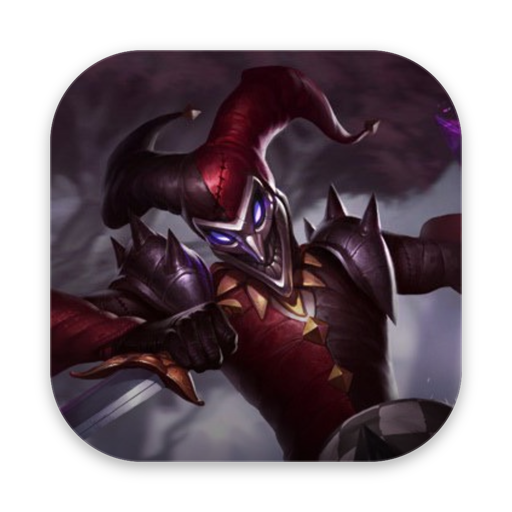
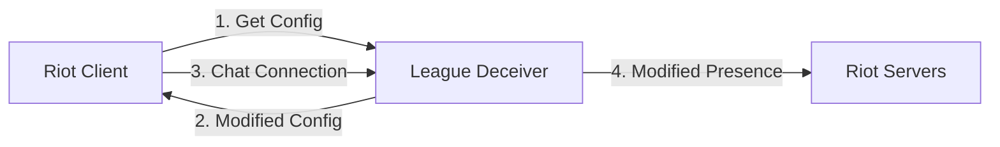

<p align="center">
  
</p>

<h1 align="center">League Deceiver</h1>

<p align="center">
  <strong>🎩 Appear offline in League of Legends, TFT, VALORANT, and Legends of Runeterra</strong><br/>
  A <a href="https://bun.sh">Bun</a> + <a href="https://electrobun.dev">Electrobun</a> port of <a href="https://github.com/molenzwiebel/Deceive">Deceive</a>
</p>

<p align="center">
  <a href="#features">Features</a> •
  <a href="#installation">Installation</a> •
  <a href="#usage">Usage</a> •
  <a href="#how-it-works">How It Works</a> •
  <a href="#faq">FAQ</a> •
  <a href="#contributing">Contributing</a>
</p>

<p align="center">
  <a href="https://github.com/Dyn4sty/deceive-js/releases">
    
  </a>
  <a href="https://github.com/Dyn4sty/deceive-js/blob/main/LICENSE">
    
  </a>
  <a href="https://github.com/Dyn4sty/deceive-js/releases">
    
  </a>
  <a href="https://github.com/Dyn4sty/deceive-js/actions/workflows/ci.yml">
    
  </a>
</p>

---

> [!CAUTION]
> The `deceive.gg` and `deceive.app` websites are **UNRELATED** to this project and to the original [Deceive](https://github.com/molenzwiebel/Deceive). The download on `deceive.app` **CONTAINS MALWARE**. Only download League Deceiver from the [Releases](https://github.com/Dyn4sty/deceive-js/releases) page.

## Features

- 🎭 **Appear Offline** - Hide your online status from friends while still being able to play
- 💬 **Full Functionality** - Chat in lobbies, queue with friends, and send invites normally
- 🎮 **Multi-Game Support** - Works with League of Legends, Teamfight Tactics, VALORANT, Legends of Runeterra, and 2XKO
- 📱 **Mobile Status** - Optionally appear as if you're on the mobile app
- 🖥️ **Windows and macOS** - Native installers for Windows and for Apple Silicon and Intel Macs, built with [Bun](https://bun.sh) and [Electrobun](https://electrobun.dev)
- 🔒 **Safe to Use** - [Riot has confirmed](https://i.thijsmolendijk.nl/deceive_ok.png) you won't get banned for using Deceive

## Installation

### Download

1. Go to the [Releases](https://github.com/Dyn4sty/deceive-js/releases) page
2. Download the installer for your system:
   - **macOS (Apple Silicon)**: `macos-arm64-Deceive.dmg`
   - **macOS (Intel)**: `macos-x64-Deceive.dmg`
   - **Windows**: `win-x64-Deceive-Setup.exe` (or `win-x64-Deceive-Setup.zip`: extract it and run `Deceive-Setup.exe`)
3. Install and open **Deceive**

On Windows, Deceive installs for your user only (no administrator rights needed) and appears in **Settings > Apps > Installed apps**, where you can uninstall it.

macOS 14 or later is required.

#### Opening Deceive on macOS for the first time

Deceive isn't notarized by Apple, so the first launch is blocked with "Apple could not verify "Deceive" is free of malware". To allow it:

1. Drag **Deceive** from the DMG into **Applications** and try to open it once.
2. Open **System Settings > Privacy & Security**, scroll down, and click **Open Anyway** next to the message about Deceive.

Or run this once in Terminal:

```bash
xattr -dr com.apple.quarantine /Applications/Deceive.app
```

If macOS says the app "is damaged", you downloaded a build from before 2.1.1; download the latest release, or use the command above.

On Windows, SmartScreen may show "Windows protected your PC". Click **More info**, then **Run anyway**.

### Build from Source

League Deceiver is an [Electrobun](https://electrobun.dev) app. You need [Bun](https://bun.sh) and [Hutch](https://docs.electrobun.dev/electrobun/guides/hutch/), Electrobun's build tool:

```bash
curl -fsSL https://hutch.blackboard.sh/hutch/install.sh | sh

git clone https://github.com/Dyn4sty/deceive-js.git
cd deceive-js
bun install

# Run in development (rebuilds on change)
bun run dev

# Build a release (app bundle, installer and update archive in artifacts/)
bun run build
```

Hutch builds for the platform it runs on, so each OS has to be built on that OS.

## Usage

Open Deceive. Like the original Deceive, it has no main window:

1. If the Riot Client is already running, Deceive asks to stop it, because it has to start the Riot Client itself to mask your status.
2. A small window asks which game to launch. Tick **Remember my choice** to skip it next time.
3. Deceive launches the game and lives in the menu bar (macOS) or system tray (Windows).

Logs are written to `deceive.log` in the app's log folder. Use **Open Logs Folder** in the menu to find it.

### Tray Menu

- **Enabled** - turn masking on or off (off means you appear with your real status)
- **Online / Offline / Mobile** - the status your friends see
- **Default Status on Startup** - a fixed status, or **Remember Last**
- **Enable Lobby Chat** - keep your presence in lobby and champion select chat
- **Restart and Launch a Different Game**
- **Open Logs Folder**
- **Quit** - stops Deceive and the Riot Client

### In-Game Commands

Once running, you can also change your status by messaging the "Deceive Active!" friend in your friends list:

- `offline` - Appear offline
- `online` - Appear online
- `mobile` - Appear on mobile
- `enable` - Enable Deceive
- `disable` - Disable Deceive
- `status` - Check current status
- `help` - Show available commands

## How It Works

League Deceiver uses a proxy approach to intercept and modify your presence:



1. **Config Proxy**: Redirects chat server connections through League Deceiver
2. **Presence Interception**: Catches your online status updates
3. **Status Modification**: Changes your status to "offline" or "mobile"
4. **Transparent Operation**: All other functionality works normally

For more technical details, see [TECHNICAL_OVERVIEW.md](docs/TECHNICAL_OVERVIEW.md).

## Supported Games

| Game                 | Status             |
| -------------------- | ------------------ |
| League of Legends    | ✅ Fully Supported |
| Teamfight Tactics    | ✅ Fully Supported |
| VALORANT             | ✅ Fully Supported |
| Legends of Runeterra | ✅ Fully Supported |
| 2XKO (Project L)     | ✅ Supported       |

## FAQ

### Where can I download League Deceiver?

Click the [Releases](https://github.com/Dyn4sty/deceive-js/releases) tab to download the latest version.

### Can I still invite people? Can they invite me?

Your friends list works as normal - you can invite everyone. However, friends cannot invite you while you appear offline, even if they enter your name manually.

### Can I talk in lobbies/champion select?

Yes! Only your global presence is hidden. You can chat in lobbies and champion/agent select without issues.

### Is this approved by Riot?

Riot has [confirmed](https://i.thijsmolendijk.nl/deceive_ok.png) that you won't get banned for using Deceive. However, it may break at any time if Riot changes their systems.

### The game says I'm online, but am I really offline?

Yes! The game client always shows you as online to yourself, but your friends see you as offline. The "Deceive Active!" friend confirms that Deceive is working.

### Why do I need to close the Riot Client first?

League Deceiver needs to launch the Riot Client with special parameters to redirect chat connections. If the client is already running, it can't intercept the chat traffic.

### How do I solve the "failing to resolve" warning for deceive-localhost.molenzwiebel.xyz?

League Deceiver points the Riot Client's chat connection at `deceive-localhost.molenzwiebel.xyz`, which normally resolves to your own computer (`127.0.0.1`), and serves a valid certificate for that domain. Some networks, ISPs, and school or work DNS servers don't resolve it. Switch your DNS to something like [Cloudflare's 1.1.1.1](https://developers.cloudflare.com/1.1.1.1/setup/) or [Google's 8.8.8.8](https://developers.google.com/speed/public-dns/docs/using), or add `127.0.0.1 deceive-localhost.molenzwiebel.xyz` to your hosts file (`/etc/hosts` on macOS, `C:\Windows\System32\drivers\etc\hosts` on Windows). Both options need administrator access.

## Contributing

Contributions are welcome! Please read our [Contributing Guide](docs/CONTRIBUTING.md) for details.

1. Fork the repository
2. Create your feature branch (`git checkout -b feature/amazing-feature`)
3. Commit your changes (`git commit -m 'feat: add amazing feature'`)
4. Push to the branch (`git push origin feature/amazing-feature`)
5. Open a Pull Request

## License

This project is licensed under the GPL-3.0 License - see the [LICENSE](LICENSE) file for details.

## Acknowledgments

- [Original Deceive](https://github.com/molenzwiebel/Deceive) by molenzwiebel - The C# application this project is based on
- The Riot Games community for testing and feedback

## Disclaimer

League Deceiver is not endorsed by Riot Games and doesn't reflect the views or opinions of Riot Games or anyone officially involved in producing or managing Riot Games properties. Riot Games, and all associated properties are trademarks or registered trademarks of Riot Games, Inc.

---

<p align="center">
  Made with ❤️ for the League community
</p>
