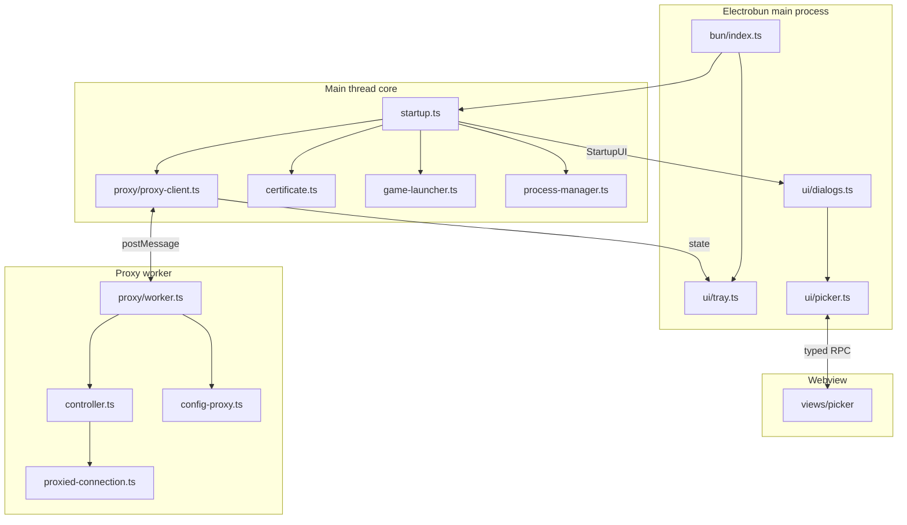
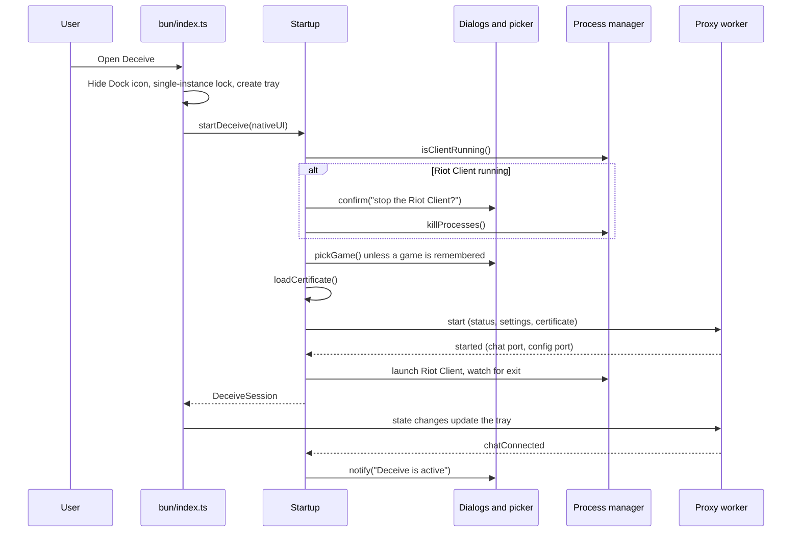
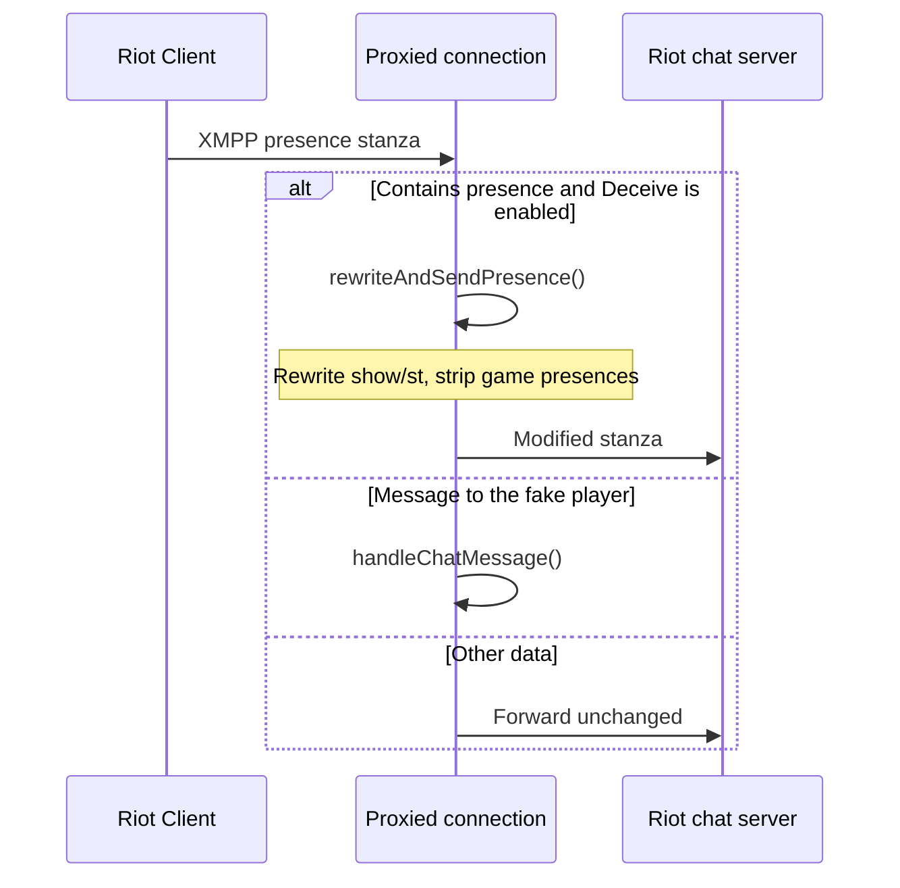

# Architecture

This document describes the high-level architecture of League Deceiver.

League Deceiver is an [Electrobun](https://electrobun.dev) desktop app with two threads:

- **Main thread** (`src/bun/index.ts`): native tray, dialogs, game picker window, settings, launching and
  watching the Riot Client. Electrobun's message boxes are synchronous, so this thread stops while one is open.
- **Proxy worker** (`src/proxy/worker.ts`, a Bun Worker): the config proxy and the chat TLS proxy. Keeping the
  sockets here means chat keeps flowing while a dialog is open. The worker never touches the settings store;
  it gets initial values from the main thread and reports changes back (`src/shared/worker-protocol.ts`).

The worker is bundled separately by the `preBuild` hook (`scripts/build-worker.ts`) and copied into the app
as `app/worker/proxy-worker.js`. The only web content is the small game picker window.

## Module Structure

```
src/
├── bun/
│   └── index.ts              # Electrobun main process: tray, single-instance lock, session lifecycle
├── startup.ts                # Startup sequence (UI-agnostic, takes a StartupUI)
├── controller.ts             # Chat proxy listener, connections, status state
├── types.ts                  # Types and enums
│
├── proxy/
│   ├── worker.ts             # Proxy worker entry point
│   ├── proxy-client.ts       # Main-thread handle for the worker
│   ├── config-proxy.ts       # HTTP proxy for the Riot client configuration
│   ├── proxied-connection.ts # Per-connection XMPP proxy, presence rewriting
│   ├── stanza-splitter.ts    # Splits the XMPP stream into complete stanzas
│   ├── socket-writer.ts      # Write queue (Bun sockets do not buffer)
│   ├── constants.ts          # Localhost domain
│   └── certificate.ts        # Trusted localhost certificate (with self-signed fallback)
│
├── launcher/
│   ├── game-launcher.ts      # Launch the Riot Client through the config proxy
│   └── process-manager.ts    # Detect, watch and stop Riot processes
│
├── ui/
│   ├── tray.ts               # Native tray menu (Electrobun Tray)
│   ├── dialogs.ts            # Native message boxes and notifications
│   └── picker.ts             # Game picker window (main-process side)
│
├── views/picker/             # Game picker web view (HTML, CSS, TS)
├── shared/
│   ├── rpc.ts                # Typed RPC schema between main process and picker
│   └── worker-protocol.ts    # Messages between main thread and proxy worker
│
├── config/
│   └── config.ts             # Persistent settings (conf)
│
└── utils/
    ├── logger.ts             # Console + deceive.log logging
    └── platform.ts           # Platform detection
```

Only `src/bun/` and `src/ui/` import Electrobun. Everything else runs under plain Bun, so `bun test`
covers the proxy, presence and certificate logic without the native runtime.

## Component Diagram



## Startup Sequence



## Stream Handling

TLS reads can end in the middle of a stanza or a multi-byte character. Both directions go through a
`StanzaSplitter`, and only complete top-level stanzas are inspected and forwarded. A presence is never
forwarded before it has been rewritten, and a presence that fails to rewrite is dropped rather than sent
unmodified. Writes go through a `SocketWriter`, which queues whatever the socket did not accept and
flushes it on `drain`.

## Presence Modification Flow



## Session Lifecycle

`startDeceive` returns a `DeceiveSession` (`controller` and `stop()`). The main process keeps one session at
a time:

- **Restart and Launch a Different Game** stops the session and the Riot Client, clears the remembered game
  and runs `startDeceive` again. The tray stays in place.
- **Quit** asks for confirmation, stops the session and the Riot Client, then calls `Utils.quit()`.
- The session ends on its own when the Riot Client exits (with a 3 second relaunch grace period) or after
  60 seconds without chat connections; the app then quits.

## Configuration

Settings are stored with `conf`:

```typescript
interface AppConfig {
  defaultGame: LaunchGame; // Remembered game, or 'prompt'
  defaultStatus: PresenceStatus; // Status of the last session
  startupStatus: StartupStatus; // 'chat' | 'offline' | 'mobile' | 'last'
  lastPromptedVersion: string;
  connectToMuc: boolean; // Lobby chat
  introductionShown: boolean; // Welcome messages are sent once
}
```

## Building

`electrobun.config.ts` describes the app bundle (views, copied assets, icons) and `hutch.config.ts` the tasks.
Hutch builds for the host platform only, so releases are built on a native runner per platform
(`.github/workflows/release.yml`).
