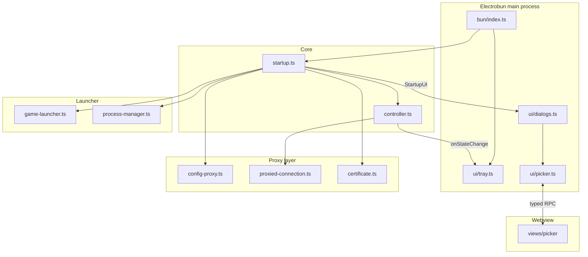
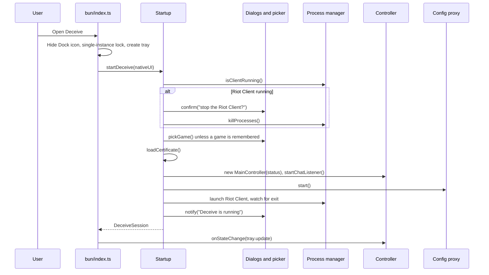
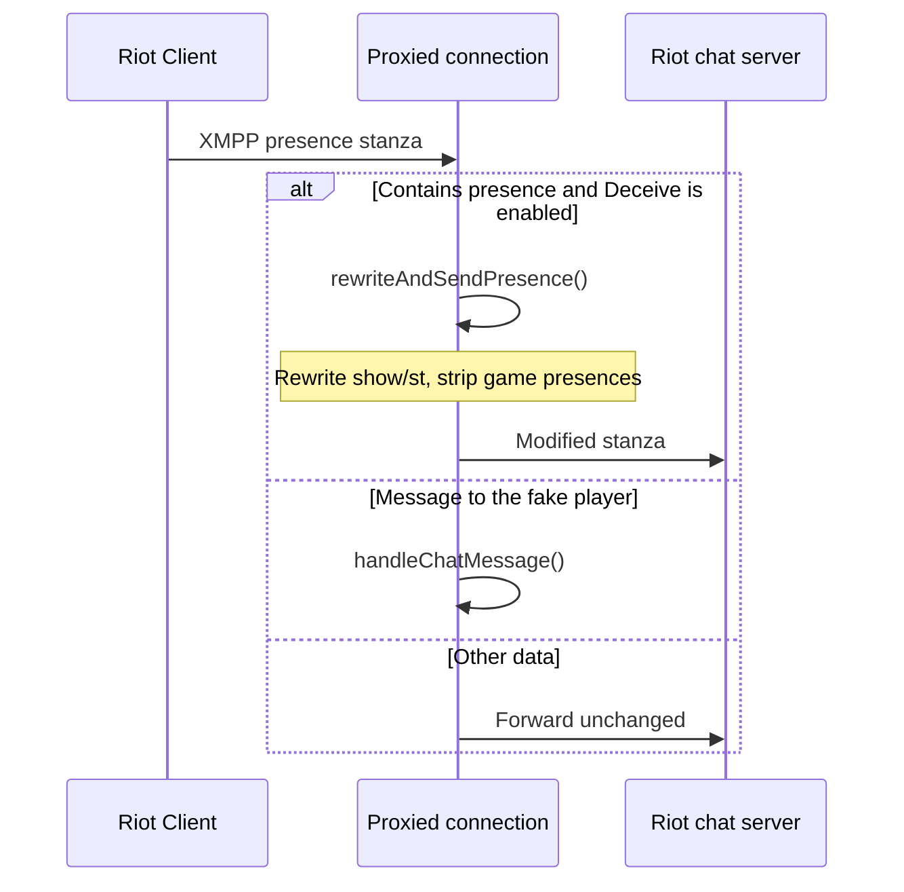

# Architecture

This document describes the high-level architecture of League Deceiver.

League Deceiver is an [Electrobun](https://electrobun.dev) desktop app. Its main process runs on Bun and
owns the proxies, the native tray and the dialogs. The only web content is the small game picker window.

## Module Structure

```
src/
├── bun/
│   └── index.ts              # Electrobun main process: tray, single-instance lock, session lifecycle
├── startup.ts                # Startup sequence (UI-agnostic, takes a StartupUI)
├── controller.ts             # Chat proxy listener, connections, status state
├── types.ts                  # Types and enums
│
├── proxy/
│   ├── config-proxy.ts       # HTTP proxy for the Riot client configuration
│   ├── proxied-connection.ts # Per-connection XMPP proxy, presence rewriting
│   └── certificate.ts        # Trusted localhost certificate (with self-signed fallback)
│
├── launcher/
│   ├── game-launcher.ts      # Launch the Riot Client through the config proxy
│   └── process-manager.ts    # Detect, watch and stop Riot processes
│
├── ui/
│   ├── tray.ts               # Native tray menu (Electrobun Tray)
│   ├── dialogs.ts            # Native message boxes and notifications
│   └── picker.ts             # Game picker window (main-process side)
│
├── views/picker/             # Game picker web view (HTML, CSS, TS)
├── shared/rpc.ts             # Typed RPC schema between main process and picker
│
├── config/
│   └── config.ts             # Persistent settings (conf)
│
└── utils/
    ├── logger.ts             # Console + deceive.log logging
    └── platform.ts           # Platform detection
```

Only `src/bun/` and `src/ui/` import Electrobun. Everything else runs under plain Bun, so `bun test`
covers the proxy, presence and certificate logic without the native runtime.

## Component Diagram



## Startup Sequence



## Presence Modification Flow



## Session Lifecycle

`startDeceive` returns a `DeceiveSession` (`controller` and `stop()`). The main process keeps one session at
a time:

- **Restart and Launch a Different Game** stops the session and the Riot Client, clears the remembered game
  and runs `startDeceive` again. The tray stays in place.
- **Quit** asks for confirmation, stops the session and the Riot Client, then calls `Utils.quit()`.
- The session ends on its own when the Riot Client exits (with a 3 second relaunch grace period) or after
  60 seconds without chat connections; the app then quits.

## Configuration

Settings are stored with `conf`:

```typescript
interface AppConfig {
  defaultGame: LaunchGame; // Remembered game, or 'prompt'
  defaultStatus: PresenceStatus; // Status of the last session
  startupStatus: StartupStatus; // 'chat' | 'offline' | 'mobile' | 'last'
  lastPromptedVersion: string;
  connectToMuc: boolean; // Lobby chat
  introductionShown: boolean; // Welcome messages are sent once
}
```

## Building

`electrobun.config.ts` describes the app bundle (views, copied assets, icons) and `hutch.config.ts` the tasks.
Hutch builds for the host platform only, so releases are built on a native runner per platform
(`.github/workflows/release.yml`).
